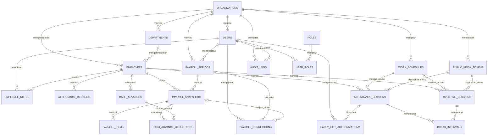

# MAKARE — Manajemen Karyawan Redone
## Spesifikasi Produk, Aturan Bisnis, UI/UX, Arsitektur Data, dan ERD

**Versi dokumen:** 1.1
**Tanggal:** 25 Oktober 2026
**Status:** Spesifikasi kebutuhan untuk audit dan implementasi bertahap
**Bahasa aplikasi:** Indonesia
**Zona waktu tampilan:** WIB (`Asia/Jakarta`)
**Format tanggal UI:** `DD/MM/YYYY`

> Dokumen ini menggabungkan spesifikasi fitur v1.0 dengan keputusan produk, UI/UX, dan aturan bisnis yang telah disepakati dalam konteks proyek. Ini adalah spesifikasi rancangan, bukan bukti bahwa fitur telah diimplementasikan atau diverifikasi di aplikasi.

---

## 1. Tujuan dan ruang lingkup

MAKARE adalah aplikasi administrasi karyawan yang mencakup data karyawan, absensi, jam kerja, lembur, penggajian, kasbon, catatan karyawan, laporan/PDF, tutup buku, Mode Koreksi, pengaturan, akun dan hak akses, serta halaman absensi publik/kiosk.

### 1.1 Cakupan rilis

- Dashboard dan ringkasan operasional.
- Data karyawan dan status aktif/nonaktif.
- Absensi manual dan absensi berbasis sesi Masuk/Keluar.
- Perhitungan durasi kerja, istirahat, keterlambatan, dan pembulatan.
- Lembur dengan sesi terpisah.
- Kasbon dan riwayat pemotongan.
- Penggajian mode **Harian Berbasis Jam** dan **Manual**.
- Pratinjau gaji, penyesuaian komponen, tutup buku dan penguncian periode.
- Mode Koreksi untuk periode yang telah dikunci.
- Catatan karyawan.
- PDF daftar karyawan, rekap gaji, slip gaji, dan rekap kehadiran.
- Laporan kehadiran, penggajian, kasbon, dan riwayat tutup buku.
- Pengaturan perusahaan, jadwal, tarif, lembur, akun, peran, dan tautan publik.
- Kiosk bersama dengan token publik yang dapat dinonaktifkan dan dirotasi.
- Audit log, validasi sisi server, serta pengujian otomatis.

### 1.2 Prinsip utama

1. Server adalah sumber kebenaran untuk otorisasi, waktu transaksi, status token, validasi sesi, dan finalisasi gaji.
2. Perubahan data master tidak boleh diam-diam mengubah snapshot penggajian yang sudah final.
3. Periode terkunci tidak boleh diedit seperti data biasa. Koreksi dilakukan melalui transaksi koreksi yang dapat diaudit.
4. Absensi Alfa adalah dokumentasi dan analitik; **tidak otomatis memotong gaji**.
5. Potongan kasbon tidak boleh melebihi saldo kasbon yang tersedia atau gaji bersih sebelum kasbon.
6. Halaman kiosk tidak menampilkan informasi pribadi atau finansial yang tidak diperlukan.
7. Implementasi pada proyek yang sudah ada harus diawali audit. Jangan menghapus atau mengganti arsitektur secara membabi buta sebelum kondisi aktual diperiksa.

---

## 2. Pengguna, peran, dan otorisasi

### 2.1 Peran

| Peran | Hak akses |
|---|---|
| Administrator | Akses penuh ke data karyawan, absensi, lembur, kasbon, penggajian, tutup buku, Mode Koreksi, catatan, PDF/laporan, pengaturan, akun, dan tautan publik. |
| Operator Input | Akses terbatas untuk memasukkan absensi hari ini melalui panel operator. Tidak dapat mengakses gaji, kasbon, pengaturan, catatan sensitif, atau riwayat yang tidak dibutuhkan. Tidak dapat mengubah absensi historis. |
| Kiosk/Mode Input Publik | Tidak memerlukan akun karyawan. Hanya dapat mencatat absensi melalui tautan publik aktif. Tidak memiliki akses panel administrasi. |

Otorisasi wajib diperiksa di server pada setiap tindakan. Menyembunyikan menu pada UI bukan kontrol akses yang memadai.

### 2.2 Batas operator

- Hanya boleh membuat absensi untuk tanggal hari ini.
- Tidak boleh mengubah atau menghapus absensi historis.
- Tidak boleh membuka modul penggajian, kasbon, pengaturan, akun, dan Mode Koreksi.
- Koreksi historis dilakukan Administrator melalui alur yang memiliki alasan dan audit log.

### 2.3 Akun dan sesi

- Password harus di-hash dengan algoritma aman melalui pustaka autentikasi yang terpelihara.
- Sesi harus memiliki masa berlaku dan mekanisme pencabutan.
- Semua endpoint/API/server action memvalidasi peran dan kepemilikan data.
- Jangan mempercayai role, employee ID, nominal, waktu, atau status yang dikirim klien tanpa validasi server.

---

## 3. Data karyawan

### 3.1 Field

| Field | Ketentuan |
|---|---|
| ID karyawan | Dibuat otomatis, unik, dan immutable. |
| Nama lengkap | Wajib. |
| Jenis kelamin | Laki-laki atau Perempuan sesuai spesifikasi awal. |
| Alamat | Data administrasi; akses terbatas. |
| Tanggal lahir | Tanggal lahir karyawan. |
| Nomor KTP | Opsional; akses sangat terbatas. |
| Nomor HP/WhatsApp | Kontak; akses terbatas. |
| Departemen | Bagian/divisi kerja. |
| Tanggal masuk | Tanggal mulai bekerja. |
| Mode penggajian | Harian Berbasis Jam atau Manual. |
| Status karyawan | Aktif atau Nonaktif. |

### 3.2 Aturan

- ID karyawan tidak boleh diubah setelah dibuat.
- Karyawan nonaktif tidak boleh membuat absensi baru.
- Menonaktifkan karyawan tidak menghapus riwayat absensi, kasbon, catatan, atau snapshot penggajian.
- Perubahan mode penggajian atau tarif berlaku ke transaksi/periode yang sesuai kebijakan; tidak mengubah snapshot final.
- PII seperti KTP, alamat, dan nomor telepon hanya ditampilkan kepada peran yang berwenang.
- Perubahan penting pada data master dicatat pada audit log.

---

## 4. Mode penggajian dan komponen

### 4.1 Harian Berbasis Jam

Rumus dasar:

`Gaji Kotor = (Tarif Reguler per Jam × Jam Reguler Dibayar) + (Tarif Lembur per Jam × Jam Lembur Dibayar) + Tambahan Penghasilan`

`Gaji Bersih Sebelum Kasbon = Gaji Kotor − Potongan Lain yang Sah`

`Gaji Bersih Dibayar = Gaji Bersih Sebelum Kasbon − Potongan Kasbon`

- Jam reguler dibayar berasal dari durasi kerja efektif yang memenuhi aturan jadwal, toleransi keterlambatan, pengakuan jam pertama, dan pembulatan.
- Lembur dicatat terpisah; tidak boleh tercampur dengan jam reguler.
- Bonus/insentif dapat ditambahkan atau disesuaikan Administrator saat meninjau penggajian.
- Tarif dan komponen yang digunakan pada finalisasi harus disimpan sebagai snapshot.
- Status Alfa tidak menghasilkan pemotongan gaji otomatis.

### 4.2 Manual

`Subtotal Komponen = Nominal × Volume`

`Gaji Kotor = Σ seluruh subtotal komponen penghasilan`

- Administrator dapat menambahkan komponen fleksibel, misalnya upah harian, borongan, bonus, atau insentif.
- Setiap komponen memiliki nama, nominal, volume, subtotal, dan keterangan opsional.
- Absensi tetap disimpan untuk dokumentasi/laporan, tetapi tidak otomatis menentukan gaji mode Manual.
- Komponen dan hasil aktual disimpan pada snapshot final.

### 4.3 Kasbon

`Potongan Kasbon = min(Saldo Kasbon Tersedia, max(0, Gaji Bersih Sebelum Kasbon))`

- Nilai awal potongan yang diusulkan adalah Rp0.
- Administrator dapat menyesuaikan nominal potongan dalam batas yang diizinkan.
- Gaji bersih setelah kasbon tidak boleh negatif.
- Sisa kasbon dibawa ke periode berikutnya.
- Pencatatan kasbon, pemotongan, pembaruan saldo, dan finalisasi harus konsisten secara transaksional.
- Permintaan finalisasi berulang tidak boleh menggandakan pemotongan.
- Riwayat kasbon dan setiap pemotongan harus dapat ditelusuri.

---

## 5. Jadwal, absensi, dan perhitungan waktu

### 5.1 Pengaturan jadwal global awal

Pada tahap awal, jadwal dapat menggunakan pengaturan global:

- Hari kerja.
- Jam masuk dan jam pulang reguler.
- Jam mulai dan selesai istirahat.
- Toleransi keterlambatan.
- Aturan pembulatan durasi.
- Aturan shift lintas tengah malam.
- Kebijakan Keluar lebih awal dan otorisasi.
- Aktivasi/penonaktifan lembur dan kebijakan istirahat lembur.

Perubahan kebijakan penting perlu menyimpan pelaku, waktu, nilai sebelum/sesudah, serta tanggal efektif. Perubahan jadwal tidak boleh diam-diam mengubah snapshot payroll yang sudah final.

### 5.2 Mode absensi manual

1. Tanggal default adalah hari ini.
2. Pengguna berwenang memilih karyawan.
3. Pilih status: Hadir, Sakit, Izin, atau Alfa.
4. Jika Hadir, waktu kehadiran default ke waktu saat ini dan dapat disesuaikan hanya oleh peran yang berhak.
5. Simpan dan tampilkan hasil.
6. Perubahan tanggal selain hari ini hanya untuk pengguna yang memiliki izin.

Jika tidak ada catatan, laporan boleh menandai ketidakhadiran berdasarkan kebijakan, tetapi harus membedakan status Alfa yang dimasukkan manual dengan status ketidakhadiran yang dihasilkan sistem.

### 5.3 Mode Harian Berbasis Jam

- Masuk dan Keluar dicatat sebagai sesi.
- Waktu resmi berasal dari server, bukan jam perangkat klien.
- Satu karyawan tidak boleh memiliki sesi reguler terbuka ganda untuk konteks yang sama.
- Keluar tanpa Masuk valid ditolak.
- Status Sakit, Izin, atau Alfa adalah catatan status, bukan sesi Masuk/Keluar.
- Sesi yang melintasi tengah malam tetap memakai **tanggal Masuk** sebagai tanggal absensi.
- Sesi lembur disimpan terpisah dari sesi reguler.
- Semua permintaan diperiksa ulang pada saat penyimpanan untuk menangani kondisi balapan/permintaan bersamaan.

### 5.4 Aturan keterlambatan dan pengakuan jam pertama

Contoh jadwal: 08:00–17:00, istirahat 1 jam, toleransi keterlambatan 30 menit.

| Waktu Masuk | Status | Aturan pembayaran jam pertama |
|---|---|---|
| 08:00 | Tepat waktu | Jam pertama diakui. |
| 08:10 | Terlambat dalam toleransi (kuning) | Jam pertama tetap diakui penuh. |
| 08:30 | Batas toleransi | Mengikuti aturan batas inklusif yang harus konsisten; default implementasi: masih dalam toleransi. |
| 08:31 | Terlambat melewati toleransi (merah) | Pengakuan jam pertama hilang; jam setelahnya tetap dapat dihitung. |
| 08:35 | Terlambat melewati toleransi (merah) | Pengakuan jam pertama hilang; jam setelahnya tetap dapat dihitung. |

Kehilangan pengakuan jam pertama **tidak menghapus seluruh gaji hari itu**. Jam reguler yang memenuhi syarat setelah jam pertama masih dihitung.

### 5.5 Urutan perhitungan waktu yang wajib

Urutan perhitungan harus deterministik dan diuji:

1. Ambil timestamp Masuk/Keluar dari server dan jadwal yang berlaku.
2. Hitung durasi bruto: `Keluar − Masuk`.
3. Batasi jam reguler hingga batas akhir jadwal reguler; waktu setelah jam pulang tidak otomatis menjadi jam reguler.
4. Kurangi hanya interval istirahat yang beririsan dengan sesi kerja.
5. Tentukan status keterlambatan berdasarkan waktu Masuk dan toleransi.
6. Terapkan aturan pengakuan jam pertama jika keterlambatan melewati toleransi.
7. Bulatkan durasi eligible satu kali sesuai aturan pembulatan.
8. Simpan terpisah durasi bruto, durasi istirahat, durasi efektif sebelum pembulatan, penyesuaian pengakuan jam pertama, dan durasi/jam yang dibayar.

Jangan mengurangi istirahat dua kali. Pembulatan tidak boleh mengembalikan jam pertama yang sudah tidak memenuhi syarat.

### 5.6 Pembulatan durasi

Aturan yang disepakati untuk sisa menit:

- 0–29 menit: dibulatkan turun ke jam penuh sebelumnya.
- 30–59 menit: dibulatkan naik ke jam penuh berikutnya.

Contoh:
- 7 jam 28 menit → 7 jam dibayar.
- 7 jam 30 menit → 8 jam dibayar.
- 7 jam 32 menit → 8 jam dibayar.

Pembulatan diterapkan pada durasi eligible setelah aturan istirahat dan pengakuan jam pertama. Jangan membulatkan beberapa kali pada tahap yang berbeda.

### 5.7 Keluar setelah jadwal

Keluar setelah jam pulang terjadwal tidak menambah jam reguler dibayar. Waktu tambahan harus dicatat sebagai sesi lembur terpisah yang memenuhi kebijakan lembur.

### 5.8 Keluar lebih awal

- Sistem mendeteksi Keluar sebelum batas jadwal.
- Bila kebijakan mengharuskan otorisasi, diperlukan PIN khusus/otorisasi transaksi yang aman.
- Otorisasi terikat pada satu transaksi, berumur pendek, dan tidak membuka sesi Administrator penuh.
- Jangan meminta atau menyimpan password utama Administrator di browser kiosk.
- Jika otorisasi tidak valid, Keluar ditolak.

### 5.9 Lembur

- Lembur memiliki sesi Masuk/Keluar tersendiri.
- Jika lembur dinonaktifkan, server menolak input lembur baru.
- Durasi lembur hanya dibayar bila catatan valid dan kebijakan lembur terpenuhi.
- Kebijakan istirahat lembur harus dapat dikonfigurasi.
- Lembur tidak boleh dihitung dua kali sebagai jam reguler dan lembur.

---

## 6. Kasbon karyawan

Data transaksi kasbon mencakup ID transaksi, karyawan, tanggal, nominal, keterangan opsional, jumlah yang telah dipotong, dan saldo tersisa.

Alur:
1. Administrator memilih karyawan, tanggal, nominal, dan keterangan.
2. Sistem membuat transaksi kasbon dan menambah saldo terutang.
3. Pratinjau tutup buku menampilkan saldo awal, potongan yang diusulkan, dan saldo setelah potongan.
4. Saat finalisasi, pemotongan disimpan sebagai transaksi tersendiri dan dikaitkan ke snapshot payroll.
5. Perubahan saldo dan finalisasi berlangsung atomik.
6. Koreksi kasbon pasca-finalisasi harus melalui Mode Koreksi dan menghasilkan transaksi penyesuaian yang dapat diaudit.

---

## 7. Penggajian, periode, dan tutup buku

### 7.1 Rentang periode

- Periode baru dimulai pada hari setelah tanggal tutup buku terakhir.
- Administrator memilih tanggal akhir periode yang tersedia hingga hari ini.
- Periode tidak boleh tumpang tindih atau difinalisasi dua kali.
- Aturan tanggal awal/akhir dan zona waktu harus konsisten di seluruh laporan.

### 7.2 Alur tutup buku

1. Administrator membuka menu Tutup Buku.
2. Sistem menentukan tanggal awal dari tutup buku terakhir.
3. Administrator memilih tanggal akhir dan mengisi keterangan opsional.
4. Sistem menghasilkan pratinjau per karyawan.
5. Pratinjau menampilkan jam reguler, jam lembur, tarif, komponen penghasilan, potongan lain, gaji kotor, saldo kasbon, potongan kasbon, sisa kasbon, dan gaji bersih.
6. Administrator meninjau serta menyesuaikan komponen dan potongan kasbon dalam batas yang berlaku.
7. Sistem menghitung ulang dan menampilkan ringkasan final.
8. Administrator mengonfirmasi.
9. Server memfinalisasi periode, menyimpan snapshot payroll, mengunci periode, mencatat pemotongan kasbon, dan memperbarui periode berikutnya dalam satu transaksi database.

### 7.3 Atomisitas dan idempotensi

- Finalisasi harus berhasil seluruhnya atau gagal seluruhnya.
- Gunakan transaksi database dan constraint/lock yang sesuai.
- Permintaan ganda tidak boleh membuat dua payroll final atau dua pemotongan kasbon.
- Data final tidak boleh dihitung ulang diam-diam dari data master terbaru.
- Slip gaji dan rekap final menggunakan snapshot terkunci ditambah penyesuaian koreksi resmi.
- Periode terkunci tidak dapat diedit melalui formulir biasa.

---

## 8. Mode Koreksi

Mode Koreksi adalah satu-satunya alur normal untuk memperbaiki data yang berdampak pada periode terkunci.

Persyaratan:
- Hanya Administrator atau peran khusus yang diizinkan dapat memulai koreksi.
- Pengguna memilih periode dan transaksi/data yang akan dikoreksi.
- Alasan koreksi wajib.
- UI menampilkan nilai sebelum dan sesudah, serta dampak terhadap jam kerja, gaji, atau kasbon.
- Simpan pelaku, waktu, alasan, referensi transaksi asli, dan nilai penyesuaian.
- Jangan mengubah atau menimpa snapshot asli secara langsung.
- Koreksi kasbon tidak boleh membuat pemotongan ganda atau perubahan saldo tanpa transaksi.
- Slip/rekap harus dapat menunjukkan hasil final asli dan penyesuaian resmi.

**Keputusan desain data yang digunakan dalam ERD:** simpan koreksi sebagai entitas penyesuaian terpisah yang mereferensikan payroll/periode/entitas sumber. Snapshot final asli tetap tidak berubah. Jika kelak dipilih model versi snapshot baru, migrasi model harus diputuskan eksplisit.

---

## 9. Catatan karyawan

- Administrator memilih karyawan dan menambahkan catatan.
- Catatan berisi judul/kategori, tanggal, isi, pembuat, dan waktu pembuatan.
- Catatan tampil dalam riwayat karyawan.
- Perubahan penting perlu memiliki riwayat.
- Akses catatan dibatasi menurut peran.
- Catatan pribadi tidak boleh tampil pada kiosk atau laporan publik.

---

## 10. PDF dan laporan

| Dokumen/laporan | Isi |
|---|---|
| Daftar Karyawan PDF | Identitas dan informasi pekerjaan yang diizinkan. |
| Rekap Gaji PDF | Karyawan, periode, penghasilan, potongan, kasbon, dan gaji bersih. |
| Slip Gaji PDF | Rincian komponen seorang karyawan untuk periode tertentu. |
| Rekap Kehadiran PDF | Hadir/Sakit/Izin/Alfa, jam kerja, lembur, keterlambatan, dan durasi. |
| Laporan Kehadiran | Filter periode/karyawan, analisis ketidakhadiran dan keterlambatan. |
| Laporan Penggajian | Ringkasan per periode berdasarkan finalisasi dan koreksi resmi. |
| Laporan Kasbon | Riwayat kasbon, pemotongan, dan saldo. |
| Riwayat Tutup Buku | Periode, pelaku, waktu, dan status finalisasi. |
| Audit Log | Aksi sensitif, pelaku, waktu, target, dan metadata yang aman. |

Laporan periode terkunci tidak menghitung ulang dari data terbaru. Data sensitif hanya dimasukkan ke PDF bila memang diperlukan dan pengguna berwenang.

---

## 11. Pengaturan sistem

Pengaturan minimum:
- Identitas perusahaan.
- Hari kerja, jam masuk/pulang reguler, dan jadwal istirahat.
- Toleransi keterlambatan.
- Aturan pembulatan dan shift lintas tengah malam.
- Tarif reguler dan lembur.
- Aktivasi/penonaktifan lembur.
- Kebijakan Keluar lebih awal.
- Mode absensi dan konfigurasi operasional.
- Akun, peran, dan sesi.
- Pengaturan tautan publik/kiosk.

Perubahan konfigurasi penting harus mencatat pelaku, waktu, nilai sebelum/sesudah, dan tanggal efektif. Kebijakan berlaku untuk periode berjalan atau periode berikutnya harus eksplisit; jangan mengubah hasil final secara retroaktif.

---

## 12. Pengaturan tautan publik

Halaman hanya dapat diakses Administrator.

### 12.1 Status dan aksi

Status UI:
- Belum Dibuat.
- Aktif.
- Nonaktif.
- Memproses.
- Gagal.

Aksi:
- Buat Tautan.
- Salin Tautan.
- Pratinjau Kiosk (tidak membuat transaksi).
- Nonaktifkan.
- Aktifkan kembali jika tidak ada indikasi kompromi.
- Buat Ulang/Rotasi Token.

### 12.2 Aturan token

- Token harus acak, panjang, sulit ditebak, dan bukan ID karyawan/database.
- Simpan token dengan aman; bila memungkinkan simpan hash token dan hanya tampilkan URL/token lengkap pada saat dibuat/dirotasi.
- Rotasi menerbitkan token baru dan langsung membatalkan token lama.
- Nonaktifkan membuat server menolak transaksi baru walaupun browser kiosk masih terbuka.
- Server memeriksa ulang status token saat penyimpanan transaksi.
- Mode Lembur di kiosk tidak dapat aktif jika lembur utama nonaktif.
- Catat tindakan, pelaku, waktu, dan hasil; jangan masukkan token rahasia ke audit log.
- UI harus mengambil URL aktual dari server, bukan mengarang URL.

---

## 13. UI/UX kiosk

### 13.1 Prinsip

- Halaman mandiri tanpa sidebar atau navigasi administrasi.
- Bahasa Indonesia, tombol besar, dan target sentuh yang mudah digunakan.
- Tanggal/jam mengikuti server dan ditampilkan dalam WIB.
- Hanya menampilkan nama dan ID singkat untuk pemilihan karyawan.
- Tidak menampilkan gaji, kasbon, KTP, alamat, nomor HP, atau catatan pribadi.
- Setelah transaksi atau pembatalan, hapus pilihan/query dan kembali ke kondisi siap.
- Tidak menyimpan antrean absensi offline untuk dikirim belakangan.

### 13.2 Alur Masuk/Keluar

1. Buka tautan publik aktif.
2. Server memvalidasi token.
3. Pilih mode Reguler atau Lembur (jika diaktifkan).
4. Cari dan pilih karyawan aktif.
5. Server memeriksa status sesi.
6. Pilih Masuk atau Keluar yang valid.
7. Tampilkan dialog konfirmasi nama, tindakan, dan waktu server.
8. Server memvalidasi ulang token, karyawan, sesi, kebijakan, dan waktu.
9. Simpan transaksi secara atomik.
10. Tampilkan hasil yang benar, lalu reset layar.

Jika jaringan terputus, jangan mengklaim berhasil. Pesan yang digunakan: **“Koneksi ke server terputus. Absensi belum tersimpan. Periksa koneksi dan coba kembali.”** Setelah koneksi pulih, periksa ulang status sebelum mengulang transaksi.

---

## 14. UI/UX aplikasi utama

### 14.1 Arah visual yang disepakati

Tema **light mode**, gaya korporat premium/banking, rapi, kontras tinggi, dan kepadatan seimbang. Gunakan gradien biru secara dominan pada hero/dashboard/kiosk, tetapi tabel, form, dan area kerja tetap terang dan mudah dibaca.

| Token | Nilai | Penggunaan |
|---|---|---|
| Midnight Navy | `#0B1F3A` | Sidebar, heading kuat, teks/elemen primer gelap. |
| Royal Blue | `#174EA6` | Aksi primer, navigasi aktif, tautan. |
| Gradient Blue | `#4F7DF3` | Sorotan, hero, aksen gradien. |
| Cool Canvas | `#F4F7FB` | Latar belakang aplikasi. |
| Primary Gradient | `linear-gradient(135deg, #174EA6, #4F7DF3)` | Hero, kartu ringkasan tertentu, CTA utama yang sesuai. |

### 14.2 Aturan komponen

- Tabel dan formulir menggunakan latar terang; jangan menggunakan gradien sebagai latar semua konten.
- Status keterlambatan: kuning untuk terlambat dalam toleransi; merah untuk melewati toleransi.
- Status transaksi harus eksplisit: memuat, siap, menyimpan, berhasil, ditolak, gagal/jaringan.
- Form harus menampilkan validasi dekat dengan field terkait.
- Tindakan final seperti Tutup Buku, Nonaktifkan tautan, Rotasi token, dan koreksi memerlukan konfirmasi.
- Tombol yang sedang memproses harus mencegah pengiriman berulang.
- Responsif untuk desktop/tablet; kiosk dioptimalkan untuk layar sentuh.
- Aksesibilitas: label input, fokus keyboard, kontras, dan pesan error yang dapat dipahami.

### 14.3 Dashboard

Dashboard menampilkan ringkasan operasional yang relevan, misalnya jumlah karyawan aktif, status kehadiran hari ini, sesi yang masih terbuka, ringkasan lembur, status periode payroll, dan tindakan cepat sesuai hak akses. Angka harus berasal dari data server dan tidak ditampilkan sebagai data nyata sebelum tersedia.

---

## 15. Validasi, kegagalan, dan state

| State/kejadian | Perilaku |
|---|---|
| Memuat | Tampilkan indikator; jangan tampilkan data lama seolah sudah terverifikasi. |
| Token tidak valid | Tolak akses dengan pesan aman. |
| Token nonaktif | Tampilkan bahwa kiosk dinonaktifkan. |
| Siap | Tampilkan jam, mode, pencarian, dan status sesi. |
| Mode/karyawan belum dipilih | Tombol tindakan tidak aktif atau tampilkan instruksi. |
| Siap Masuk | Masuk tersedia jika tidak ada sesi terbuka dan kebijakan mengizinkan. |
| Siap Keluar | Keluar tersedia jika ada sesi Masuk valid yang belum ditutup. |
| Konfirmasi | Tampilkan ringkasan transaksi sebelum penyimpanan. |
| Menyimpan | Cegah submit ganda. |
| Berhasil | Tampilkan hasil yang dikonfirmasi server dan reset layar. |
| Ditolak | Jelaskan alasan dan langkah berikutnya tanpa membocorkan data sensitif. |
| Gangguan jaringan | Nyatakan belum tersimpan; periksa status sebelum retry. |

Validasi server wajib mencakup:
- Token dikenal, aktif, dan belum dicabut.
- Karyawan aktif dan terikat ke organisasi/tenant yang benar.
- Mode lembur aktif jika transaksi lembur.
- Waktu berasal dari server.
- Keluar memiliki Masuk yang valid dan terbuka.
- Tidak ada sesi ganda.
- Konkurensi ditangani melalui constraint, lock, atau transaksi yang sesuai.
- Status token, sesi, dan kebijakan diperiksa kembali pada saat menyimpan.
- Kegagalan tidak meninggalkan data parsial.
- Nilai uang dan durasi divalidasi serta dibatasi.
- Semua operasi terikat pada organisasi/tenant yang benar jika multi-tenant diaktifkan.

---

## 16. Keamanan, privasi, dan audit

- Gunakan HTTPS.
- Terapkan otorisasi server-side pada semua operasi.
- Validasi input dengan skema dan validasi bisnis di server.
- Batasi laju permintaan, terutama pencarian publik dan endpoint kiosk.
- Gunakan idempotency key atau mekanisme ekuivalen untuk operasi yang dapat dikirim ulang.
- Terapkan transaksi database untuk finalisasi payroll, pemotongan kasbon, dan pencatatan absensi yang saling bergantung.
- Lindungi PII dan data finansial; minimalkan akses dan logging.
- Jangan mencatat token publik, password, atau rahasia dalam log.
- Terapkan kebijakan cache yang aman untuk kiosk.
- Catat audit untuk perubahan tarif/jadwal, status karyawan, token publik, otorisasi Keluar awal, finalisasi, koreksi, perubahan akun/peran, dan operasi sensitif.
- Audit log setidaknya berisi aktor, waktu server, aksi, jenis/ID objek, hasil, alasan bila relevan, dan metadata perubahan sebelum/sesudah yang aman.
- Audit log tidak boleh dapat diedit melalui UI biasa.
- Backup dan prosedur pemulihan database harus ditetapkan sebelum produksi.

---

## 17. Rekomendasi arsitektur implementasi

Bagian ini adalah rekomendasi teknis, bukan kondisi stack yang sudah diverifikasi pada proyek Lovable saat ini.

### 17.1 Pendekatan

- Audit proyek Lovable yang ada terlebih dahulu: struktur, dependensi, routing, auth, database, skema, integrasi, dan fitur yang sudah berjalan.
- Pertahankan komponen dan data yang valid; jangan melakukan rewrite atau migrasi destruktif tanpa keputusan eksplisit.
- Utamakan **modular monolith** untuk ruang lingkup ini, dengan domain terpisah: identity/access, employees, attendance, overtime, payroll, advances, corrections, reports, settings, kiosk, audit.
- TypeScript, React/Next.js, UI utility-first/component library, PostgreSQL, ORM dan validasi skema merupakan opsi yang telah dibahas; pilihan final mengikuti hasil audit proyek dan kompatibilitas hosting.
- Gunakan migrasi database yang terkontrol dan dapat ditinjau.
- Gunakan unit test untuk aturan payroll, integration test untuk transaksi, dan end-to-end test untuk alur utama.
- CI harus menjalankan lint, type-check, test, dan build.
- Jangan menyatakan produksi siap sebelum pengujian, konfigurasi keamanan, backup, dan verifikasi deployment benar-benar dilakukan.

### 17.2 Domain backend yang disarankan

- `employees`: data karyawan dan status.
- `attendance`: status harian dan sesi reguler.
- `overtime`: sesi lembur.
- `payroll`: periode, preview, snapshot final, slip gaji.
- `advances`: kasbon dan pemotongan.
- `corrections`: penyesuaian atas periode final.
- `notes`: catatan karyawan.
- `settings`: jadwal, tarif default, kebijakan.
- `public-kiosk`: token dan transaksi publik.
- `reports`: pembacaan data final dan ekspor.
- `audit`: jejak aksi sensitif.

---

## 18. Model data konseptual

ERD berikut adalah model konseptual awal agar kebutuhan fitur dan relasi utama jelas. Nama tabel/kolom dapat disesuaikan dengan skema proyek yang ditemukan saat audit, tetapi semantik dan batas integritasnya harus dipertahankan.

### 18.1 Entitas utama

- `organizations`: perusahaan/tenant jika aplikasi mendukung lebih dari satu organisasi.
- `users`: akun login.
- `roles` dan `user_roles`: hak akses akun.
- `employees`: data karyawan.
- `departments`: bagian/divisi.
- `attendance_records`: catatan status harian manual atau status ketidakhadiran.
- `attendance_sessions`: sesi Masuk/Keluar reguler.
- `overtime_sessions`: sesi Masuk/Keluar lembur.
- `work_schedules`: versi jadwal/policy yang memiliki tanggal efektif.
- `break_intervals`: interval istirahat terjadwal atau interval yang diterapkan pada sesi.
- `payroll_periods`: rentang periode dan status draft/final.
- `payroll_snapshots`: hasil payroll final per karyawan dalam satu periode.
- `payroll_items`: komponen penghasilan/potongan yang menjadi bagian snapshot.
- `cash_advances`: transaksi kasbon yang menambah saldo terutang.
- `cash_advance_deductions`: transaksi pemotongan kasbon yang terikat ke payroll.
- `payroll_corrections`: koreksi/penyesuaian yang tidak menimpa snapshot asli.
- `employee_notes`: catatan karyawan.
- `public_kiosk_tokens`: token tautan publik dan statusnya.
- `early_exit_authorizations`: otorisasi terbatas untuk Keluar lebih awal.
- `audit_logs`: audit aksi penting.

### 18.2 ERD Mermaid



### 18.3 Kamus data minimum

> Tipe data berikut bersifat konseptual. Sesuaikan sintaks dengan database/ORM yang dipilih. Gunakan integer untuk durasi menit dan tipe decimal/numeric untuk nilai uang; hindari floating point untuk uang.

| Tabel | Kolom penting | Catatan integritas |
|---|---|---|
| `organizations` | `id`, `name`, `timezone`, `created_at` | `timezone` default `Asia/Jakarta`. Jika hanya satu perusahaan, organisasi tetap dapat dipertahankan untuk konsistensi atau dihilangkan melalui keputusan eksplisit. |
| `users` | `id`, `organization_id`, `name`, `email`, `password_hash/auth_provider_id`, `is_active`, timestamps | Identitas akun terpisah dari data karyawan. |
| `roles` | `id`, `key`, `name` | `key` unik, mis. `admin`, `operator`. |
| `user_roles` | `user_id`, `role_id` | Unique gabungan; hindari duplikasi role. |
| `departments` | `id`, `organization_id`, `name`, `is_active` | Nama dapat unik per organisasi sesuai kebijakan. |
| `employees` | `id`, `organization_id`, `employee_code`, `full_name`, `gender`, `address`, `birth_date`, `national_id`, `phone`, `department_id`, `hire_date`, `payroll_mode`, `is_active`, timestamps | `employee_code` unik per organisasi; immutable; data sensitif dibatasi. |
| `work_schedules` | `id`, `organization_id`, `name`, `effective_from`, `effective_to`, `work_days`, `start_time`, `end_time`, `break_policy`, `late_tolerance_minutes`, `rounding_policy`, `first_hour_rule`, `early_exit_policy` | Jadwal berversi/tanggal efektif agar perhitungan historis dapat direkonstruksi. |
| `attendance_records` | `id`, `employee_id`, `work_date`, `status`, `source`, `recorded_at`, `recorded_by`, `notes` | `source` membedakan input manual/operator/kiosk/system; aturan unik status per tanggal perlu ditentukan. |
| `attendance_sessions` | `id`, `employee_id`, `work_date`, `check_in_at`, `check_out_at`, `schedule_id`, `raw_minutes`, `break_minutes`, `effective_minutes`, `late_minutes`, `late_status`, `first_hour_forfeited`, `eligible_minutes`, `payable_hours/minutes`, `early_exit_authorization_id`, `source_token_id`, `created_at` | `work_date` mengikuti tanggal Masuk; satu sesi terbuka reguler per karyawan sesuai kebijakan. Simpan komponen perhitungan agar dapat diaudit. |
| `overtime_sessions` | `id`, `employee_id`, `work_date`, `check_in_at`, `check_out_at`, `schedule_id`, `raw_minutes`, `break_minutes`, `payable_minutes`, `status`, `source_token_id` | Sesi terpisah dari sesi reguler; validasi fitur lembur di server. |
| `break_intervals` | `id`, `attendance_session_id` nullable, `overtime_session_id` nullable, `start_at`, `end_at`, `duration_minutes`, `policy_source` | Tepat satu FK sesi harus terisi; hanya interval yang beririsan dikurangkan. |
| `payroll_periods` | `id`, `organization_id`, `start_date`, `end_date`, `status`, `notes`, `created_by`, `finalized_by`, `finalized_at`, `idempotency_key` | Rentang tidak tumpang tindih; status final tidak dapat kembali ke draft melalui UI biasa. |
| `payroll_snapshots` | `id`, `payroll_period_id`, `employee_id`, `payroll_mode_snapshot`, `regular_rate_snapshot`, `overtime_rate_snapshot`, `regular_minutes`, `overtime_minutes`, `gross_amount`, `other_deductions`, `net_before_advance`, `advance_deduction`, `net_pay`, `calculation_details_json`, `finalized_at` | Unique gabungan `(payroll_period_id, employee_id)`; snapshot tidak diedit setelah final. |
| `payroll_items` | `id`, `payroll_snapshot_id`, `item_type`, `name`, `amount`, `volume`, `subtotal`, `description` | Simpan komponen aktual yang digunakan saat finalisasi. |
| `cash_advances` | `id`, `employee_id`, `transaction_date`, `amount`, `description`, `created_by`, `created_at` | Nilai positif; transaksi historis tidak dihapus diam-diam. |
| `cash_advance_deductions` | `id`, `cash_advance_id`, `payroll_snapshot_id`, `amount`, `created_at`, `created_by` | Unique/idempotency mencegah pemotongan ganda; jumlah total tidak boleh melebihi saldo dan batas payroll. |
| `payroll_corrections` | `id`, `payroll_period_id`, `payroll_snapshot_id` nullable, `target_type`, `target_id`, `reason`, `before_json`, `after_json`, `adjustment_amount`, `created_by`, `created_at`, `status`, `approved_by`, `approved_at` | Tidak menimpa snapshot asli; alasan wajib; status/approval disesuaikan kebijakan. |
| `employee_notes` | `id`, `employee_id`, `title`, `category`, `note_date`, `body`, `created_by`, timestamps | Akses dibatasi; perubahan penting diaudit. |
| `public_kiosk_tokens` | `id`, `organization_id`, `token_hash`, `label`, `is_active`, `mode_regular_enabled`, `mode_overtime_enabled`, `created_by`, `created_at`, `revoked_at`, `rotated_from_id`, `last_used_at` | Token rahasia tidak disimpan ke log; rotasi membatalkan token lama. |
| `early_exit_authorizations` | `id`, `employee_id`, `attendance_session_id` nullable, `authorization_hash/reference`, `expires_at`, `used_at`, `authorized_by`, `created_at` | Sekali pakai, terikat transaksi, kedaluwarsa singkat; jangan simpan PIN teks biasa. |
| `audit_logs` | `id`, `organization_id`, `actor_user_id` nullable, `action`, `entity_type`, `entity_id`, `before_json`, `after_json`, `reason`, `result`, `created_at`, `request_id` | Append-only bagi aplikasi; hindari rahasia dan PII yang tidak perlu. |

### 18.4 Constraint dan indeks yang perlu dipertimbangkan

- Unique `(organization_id, employee_code)`.
- Unique `(payroll_period_id, employee_id)` pada snapshot.
- Constraint untuk `end_date >= start_date`.
- Constraint nominal uang tidak negatif, kecuali tipe adjustment secara eksplisit mendukung nilai negatif.
- Constraint tepat satu referensi sesi pada `break_intervals`.
- Indeks pada `employee_id`, `work_date`, `check_in_at`, rentang periode, status, dan foreign key.
- Partial unique index atau mekanisme transaksi untuk mencegah lebih dari satu sesi terbuka untuk satu karyawan dan jenis sesi.
- Constraint atau locking untuk mencegah periode payroll tumpang tindih/finalisasi ganda.
- Idempotency key untuk finalisasi dan aksi kiosk yang dapat terkirim ulang.
- Foreign key dan strategi penghapusan harus menjaga histori transaksi; utamakan soft-delete/nonaktif untuk entitas yang memiliki histori finansial.

---

## 19. Aturan implementasi dan pseudo-alur

### 19.1 Perhitungan sesi reguler

```text
input: check_in_at, check_out_at, schedule_version, break_policy
assert check_out_at exists and check_out_at > check_in_at

work_date = date(check_in_at in Asia/Jakarta)
raw_duration = check_out_at - check_in_at
regular_end = scheduled end resolved against the shift/work date
capped_end = min(check_out_at, regular_end)
eligible_interval = [check_in_at, max(check_in_at, capped_end)]
break_minutes = sum(overlap(eligible_interval, each applicable break))
effective_minutes = max(0, duration(eligible_interval) - break_minutes)

late_minutes = max(0, minutes(check_in_at - scheduled_start))
late_status = compare check_in_at to tolerance boundary

if late_minutes exceeds configured tolerance:
    mark first-hour recognition forfeited
    exclude the scheduled first-hour block from payable eligible duration
    do not discard later eligible time

payable_minutes = apply configured rounding exactly once to eligible duration
persist all intermediate values and schedule version
```

**Catatan:** definisi tepat “jam pertama” yang dikecualikan harus diterapkan secara konsisten pada interval jadwal, bukan sekadar mengurangi 60 menit secara membabi buta pada semua kemungkinan sesi. Kasus istirahat yang beririsan dengan jam pertama, masuk setelah jam pertama, dan shift lintas tengah malam harus memiliki test eksplisit sebelum rilis.

### 19.2 Finalisasi payroll

```text
begin database transaction
lock/validate payroll period and employee/advance balances
assert period is not already finalized
assert requested period does not overlap a finalized period
compute preview from eligible source transactions and applicable policy versions
validate all amounts and advance deduction limits
create one payroll snapshot per employee
create payroll item snapshots
create cash advance deduction transactions
mark payroll period finalized with actor/time
commit
```

Jika salah satu langkah gagal, rollback semua perubahan. Pengulangan request dengan idempotency key yang sama harus mengembalikan hasil final yang sama, bukan membuat transaksi baru.

### 19.3 Kiosk check-in/out

```text
validate token is known, active, and not revoked
validate employee is active and belongs to the same organization
validate selected mode is enabled
load current session state from database
validate action is allowed
obtain timestamp from server
revalidate token/session/policy at write time
write transaction atomically with duplicate/concurrency protection
return confirmed server result
```

---

## 20. Rencana pengujian dan kriteria penerimaan

### 20.1 Pengujian aturan bisnis

- Masuk tepat waktu.
- Terlambat dalam toleransi (mis. 08:10 untuk jadwal 08:00, toleransi 30 menit).
- Batas toleransi tepat (08:30) dan melewati satu menit (08:31).
- Jam pertama hilang tetapi jam kerja setelahnya tetap dibayar.
- Durasi 7:28, 7:30, 7:32 dan batas pembulatan lain.
- Istirahat beririsan penuh/sebagian/tidak beririsan.
- Keluar setelah jadwal tidak menambah jam reguler.
- Shift melewati tengah malam menggunakan tanggal Masuk.
- Sesi terbuka ganda dan Keluar tanpa Masuk ditolak.
- Lembur nonaktif ditolak oleh server.
- Alfa tidak otomatis memotong gaji.
- Mode Manual tidak mengambil gaji dari jam absensi secara otomatis.
- Potongan kasbon Rp0 secara default; batas saldo dan gaji bersih ditaati.
- Gaji bersih tidak negatif.
- Finalisasi ganda tidak menggandakan snapshot/potongan.
- Periode terkunci tidak dapat diubah tanpa Mode Koreksi.
- Koreksi menyimpan alasan, pelaku, waktu, before/after, dan dampak.
- Token dinonaktifkan/dirotasi ditolak server, termasuk ketika halaman kiosk lama masih terbuka.
- Permintaan bersamaan tidak membuat absensi atau pemotongan ganda.
- Kegagalan jaringan tidak menampilkan sukses palsu.

### 20.2 Kriteria penerimaan produk

| Area | Kriteria lulus |
|---|---|
| Karyawan | ID otomatis/unik/immutable; karyawan nonaktif tidak dapat absensi. |
| Hak akses | Operator dan kiosk tidak dapat mengakses data/aksi Administrator melalui endpoint langsung. |
| Absensi | Masuk/Keluar mengikuti status sesi; tidak ada sesi ganda; waktu dari server. |
| Waktu | Istirahat dihitung sesuai overlap; shift lintas tengah malam benar; pembulatan hanya sekali. |
| Payroll | Tarif/komponen disnapshot; Alfa tidak otomatis memotong gaji; perhitungan bisa ditelusuri. |
| Kasbon | Potongan dibatasi saldo dan net sebelum kasbon; tidak ada potongan ganda. |
| Tutup buku | Finalisasi atomik dan idempoten; snapshot terkunci tidak berubah oleh edit master. |
| Koreksi | Alasan dan audit lengkap; snapshot asli tetap tersedia; penyesuaian terpisah. |
| Kiosk | Token aktif diperlukan; rotasi langsung mencabut token lama; tidak mengekspos PII/finansial. |
| UI/UX | Palet yang disepakati dipakai; status, loading, error, dan konfirmasi jelas. |
| Laporan | Data final berasal dari snapshot final dan koreksi resmi. |
| Keamanan | Otorisasi server-side, audit, rate limiting, dan validasi input. |
| Build | Lint, type-check, unit/integration/E2E test, dan build lolos sebelum klaim siap. |

---

## 21. Keputusan yang masih perlu dikunci

Spesifikasi awal menyebut sejumlah detail perlu diputuskan. Berikut daftar yang harus dikonfirmasi sebelum dianggap final secara implementasi:

1. Apakah aplikasi hanya untuk satu perusahaan atau harus multi-tenant sejak awal.
2. Apakah Operator Input hanya boleh membuat absensi hari ini atau juga dapat mengoreksi catatan hari ini sebelum tutup hari.
3. Apakah toleransi 30 menit bersifat inklusif pada tepat 08:30. Default rancangan dokumen ini: inklusif.
4. Definisi teknis pengakuan “jam pertama”: blok jam jadwal pertama atau pengurangan 60 menit dari eligible duration. Implementasi harus memilih satu definisi dan mengujinya.
5. Bagaimana interval istirahat diterapkan ketika karyawan terlambat, pulang awal, atau sesi tidak mencakup seluruh jadwal istirahat.
6. Bagaimana pembulatan diterapkan ketika sisa menit melewati batas setelah pengakuan jam pertama.
7. Apakah tarif reguler/lembur berada pada level perusahaan, karyawan, atau kombinasi keduanya. Rancangan mengasumsikan tarif aktual per karyawan dapat disnapshot.
8. Apakah koreksi harus disetujui oleh Administrator kedua atau cukup satu Administrator dengan alasan dan audit.
9. Apakah koreksi payroll menghasilkan slip versi baru, adjustment terpisah, atau keduanya. ERD awal memilih adjustment terpisah dan snapshot asli immutable.
10. Format nomor karyawan dan apakah boleh menggunakan kembali nomor lama (rekomendasi: tidak).
11. Apakah diperlukan beberapa shift/jadwal per karyawan atau jadwal global cukup untuk fase awal.
12. Kebijakan durasi sesi terbuka yang tidak pernah Keluar, dan siapa yang boleh menutupnya secara administratif.
13. Kebijakan pembatalan/penghapusan transaksi salah sebelum periode dikunci.
14. Kebutuhan multi-cabang, mata uang selain IDR, pajak/iuran, ekspor akuntansi, atau integrasi pihak ketiga.
15. Kebijakan retensi, ekspor, backup, dan penghapusan data pribadi.

Jika belum diputuskan, jangan diam-diam membuat kebijakan bisnis baru. Dokumentasikan asumsi yang digunakan dan minta persetujuan pemilik produk untuk keputusan yang memengaruhi gaji atau data historis.

---

## 22. Urutan implementasi bertahap

### Tahap 0 — Audit proyek saat ini
- Periksa file, dependensi, routing, halaman, auth, database, skema, integrasi, dan status deployment.
- Buat daftar fitur yang sudah ada, parsial, rusak, dan belum ada.
- Catat risiko migrasi; jangan menghapus data atau melakukan rewrite destruktif.
- Cocokkan hasil audit terhadap spesifikasi ini.

### Tahap 1 — Fondasi
- Tetapkan organisasi/tenant, auth, peran, navigasi, design tokens, validasi, audit log, dan migrasi database.
- Buat test harness dan CI.

### Tahap 2 — Data karyawan dan pengaturan
- CRUD karyawan/departemen, status aktif/nonaktif, tarif, jadwal, dan kebijakan.
- Pastikan perubahan master dan snapshot dipisahkan.

### Tahap 3 — Absensi dan kiosk
- Panel operator, status manual, sesi reguler, lembur, token kiosk, Keluar lebih awal, idempotensi dan concurrency.
- Tambahkan pengujian zona waktu, shift tengah malam, dan kegagalan jaringan.

### Tahap 4 — Kasbon dan payroll preview
- Buku kasbon, komponen Manual, hitung payroll, rincian per karyawan, dan batas potongan.
- Uji seluruh edge case perhitungan.

### Tahap 5 — Tutup buku dan koreksi
- Finalisasi atomik, snapshot immutable, slip/rekap final, adjustment koreksi, dan audit.

### Tahap 6 — Catatan, laporan, PDF, dashboard
- Implementasi laporan berbasis sumber final, filter, ekspor PDF, dan dashboard.

### Tahap 7 — Hardening dan rilis
- Security review, aksesibilitas, rate limiting, backup/restore, test E2E, verifikasi build/deployment, dan dokumentasi operasional.

Setiap tahap harus diverifikasi melalui implementasi aktual dan test. Penyelesaian tahap tidak boleh diklaim hanya berdasarkan prompt atau rancangan.

---

## 23. Glosarium

| Istilah | Definisi |
|---|---|
| Durasi bruto | Selisih waktu Keluar dan Masuk sebelum pengurangan istirahat. |
| Durasi efektif | Durasi sesi yang memenuhi batas waktu reguler setelah pengurangan istirahat. |
| Durasi eligible | Durasi yang tersisa setelah aturan jadwal dan pengakuan jam pertama diterapkan. |
| Durasi dibayar | Durasi eligible setelah pembulatan sesuai kebijakan. |
| Snapshot payroll | Salinan nilai aktual yang digunakan saat periode difinalisasi. |
| Tutup buku | Finalisasi dan penguncian periode payroll beserta snapshot dan pemotongan kasbon. |
| Mode Koreksi | Mekanisme penyesuaian transaksi/perhitungan periode yang sudah final tanpa menimpa snapshot asli. |
| Kiosk | Halaman publik pada perangkat bersama untuk mencatat absensi. |
| Idempotensi | Pengulangan permintaan yang sama tidak membuat efek transaksi tambahan. |
| WIB | Waktu Indonesia Barat; zona `Asia/Jakarta`. |

---

## 24. Riwayat dokumen

| Versi | Tanggal | Perubahan |
|---|---|---|
| 1.0 | 25 Oktober 2026 | Spesifikasi awal fitur, UI/UX, alur, validasi, keamanan, dan kriteria penerimaan. |
| 1.1 | 25 Oktober 2026 | Konsolidasi keputusan UI/UX dan aturan bisnis, model data konseptual, ERD Mermaid, rekomendasi implementasi bertahap, dan rencana pengujian. |

**Akhir dokumen.**
